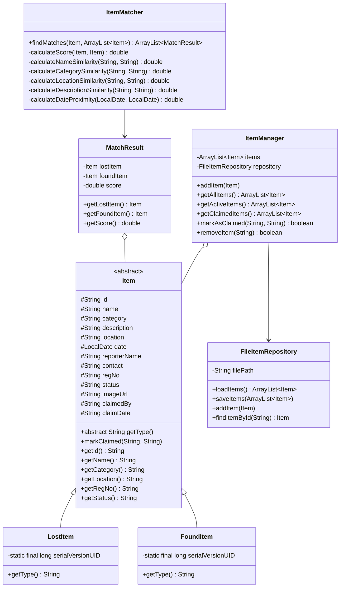

# Manipal University Jaipur (MUJ)
## Department of Computer Science & Engineering
### Object-Oriented Programming (Java) — Project Report & Viva Guide

---

# Project Title: Campus Lost & Found Matching System
**Campus Customization**: Manipal University Jaipur (MUJ)  
**Primary Language**: Pure Java (JDK 21 / 26)  
**Architecture**: Multi-Tiered Architecture (Model-Service-Repository-Controller)  
**Persistence**: Object Serialization (`items.dat` with `ObjectInputStream` / `ObjectOutputStream`)  
**Deployment**: 
1. Dual-mode Standalone Multi-threaded Engine (`ServerLauncher.java` via `run-server.bat`)
2. Standard Java EE Servlet WAR (`lostfound.war` / `web.xml`)
**Frontend**: Modern Semantic HTML5, Vanilla JavaScript (`app.js`), Sapphire & Royal Blue UI (`styles.css`)

---

## 1. Executive Summary & Problem Statement

Across university campuses like **Manipal University Jaipur (MUJ)**—spanning over 122 acres and multiple academic blocks (AB1, AB2, AB3, LHC, Central Library, Food Court, Hostels)—misplacing essential belongings (student ID cards, scientific calculators, laptops, wallets, keys) is a daily occurrence.

Traditional lost-and-found methods rely on fragmented WhatsApp/Telegram groups or physical notice boards. These suffer from:
- Lack of centralized indexing.
- No automated similarity matching.
- High risk of fraudulent ownership claims without student registration verification.
- Zero analytics on high-loss campus zones.

The **Campus Lost & Found Matching System** solves this through a pure Java OOP system incorporating a multi-factor heuristic compatibility engine, student registration number (`regNo`) verification, safe custody lifecycle tracking (`ACTIVE` $\rightarrow$ `CLAIMED`), image previews, administrative CSV reports, and visual campus analytics.

---

## 2. Core OOP Principles Implementation

This project was built to illustrate the 4 foundational pillars of Object-Oriented Programming:

### 2.1 Abstraction
- **Abstract Superclass `model.Item`**:
  `Item` defines the abstract contract for all trackable items. It defines shared state (`id`, `name`, `category`, `description`, `location`, `date`, `reporterName`, `contact`, `regNo`, `status`, `imageUrl`, `claimedBy`, `claimDate`) and enforces the implementation of the abstract method:
  ```java
  public abstract String getType();
  ```
- **Service Layer Abstraction**:
  `service.ItemMatcher` abstracts the mathematical complexity of heuristic matching (Jaccard token set intersection, string distance, and date proximity deltas) behind a simple interface:
  ```java
  public ArrayList<MatchResult> findMatches(Item lostItem, ArrayList<Item> allItems);
  ```
- **Storage Abstraction**:
  `storage.FileItemRepository` hides the complexities of disk I/O, binary streams, and serialization locks behind high-level CRUD methods: `loadItems()`, `saveItems()`, `addItem()`, and `findItemById()`.

### 2.2 Inheritance
- **Hierarchy (`LostItem` and `FoundItem` inherit from `Item`)**:
  - `public class LostItem extends Item`
  - `public class FoundItem extends Item`
- **Code Reuse**:
  Both subclasses reuse all 12 common fields and behaviors from `Item` through `super(...)` constructors, while providing polymorphic specializations:
  ```java
  @Override
  public String getType() {
      return "LOST";
  }
  ```
  and
  ```java
  @Override
  public String getType() {
      return "FOUND";
  }
  ```

### 2.3 Encapsulation
- **Data Hiding**: All item attributes in `Item`, `MatchResult`, and `ItemManager` are declared `private` or `protected`.
- **Accessor / Mutator Validation**: Access to fields is strictly guarded by public getters and setters.
- **State Transition Control**:
  Item status cannot be corrupted with arbitrary values. The method `markClaimed(String claimant, String claimDate)` encapsulates the state transition to `CLAIMED` along with audit information:
  ```java
  public void markClaimed(String claimant, String claimDate) {
      this.status = "CLAIMED";
      this.claimedBy = claimant;
      this.claimDate = claimDate;
  }
  ```
- **Thread Safety in Storage**:
  `FileItemRepository` encapsulates file reads and writes within synchronized blocks and `ReentrantReadWriteLock` to guarantee transactional integrity when saving `items.dat`.

### 2.4 Polymorphism
- **Dynamic Method Dispatch (Runtime Polymorphism)**:
  Collections of type `ArrayList<Item>` store both `LostItem` and `FoundItem` instances. When iterating:
  ```java
  for (Item item : items) {
      System.out.println(item.getType() + " | " + item.getName());
  }
  ```
  Java resolves the correct `getType()` method at runtime based on the actual object instance, eliminating rigid `if (item instanceof ...)` checks.
- **Method Overloading (Compile-Time Polymorphism)**:
  - Overloaded constructors in `Item`, `LostItem`, and `FoundItem` allow instantiation with legacy parameters (for backwards compatibility with `items.dat`) or with newly introduced parameters (`regNo`, `status`, `imageUrl`).
  - Overloaded search methods in `SearchService`:
    - `searchByName(String name)`
    - `searchByCategory(String category)`
    - `searchByLocation(String location)`
    - `searchById(String id)`

---

## 3. System Architecture & Class Hierarchy



---

## 4. Algorithmic Matching Engine (`ItemMatcher.java`)

When an item is reported, `ItemMatcher` evaluates it against active counterpart items using a multi-factor weighted heuristic function:

$$\text{Match Score} = S_{\text{name}} + S_{\text{cat}} + S_{\text{loc}} + S_{\text{desc}} + S_{\text{date}}$$

Where maximum possible score is $100\%$:

| Component | Weight | Heuristic Method |
| :--- | :---: | :--- |
| **Name Similarity** | $20\%$ | Exact match = $1.0$ ($20$ pts); Partial substring = $0.7$ ($14$ pts) |
| **Category Match** | $20\%$ | Exact category match = $20$ pts; Mismatch = $0$ pts |
| **Location Match** | $20\%$ | Building/sub-location containment (e.g. `"AB2"` in `"AB2 Room 310"`) = $20$ pts |
| **Description Match** | $25\%$ | **Jaccard Word Similarity**: $J(A, B) = \frac{\|A \cap B\|}{\|A \cup B\|} \times 25$ pts |
| **Date Proximity** | $15\%$ | Same day = $15$ pts; $\le 2$ days = $10$ pts; $\le 7$ days = $5$ pts |

> **Cutoff Filter**: Pairs scoring $< 30\%$ are rejected as noise.  
> **Lifecycle Exemption**: Items marked as `CLAIMED` are automatically excluded from match computation.

---

## 5. Manipal University Jaipur (MUJ) Campus Customizations

1. **Campus Landmark Integration**:
   - Central Library (1st/2nd floor reading rooms)
   - Academic Block 1 (AB1)
   - Academic Block 2 (AB2)
   - Academic Block 3 (AB3)
   - Lecture Hall Complex (LHC Audi 1-3)
   - Food Court & Student Mess
   - Hostel Blocks (B1 to B12, G1 to G4)
   - Sports Complex & Campus Quad
2. **Student Registration Number Enforcement**:
   - `regNo` field required in reports to prevent spam and link claims directly to MUJ student records.
3. **Custody Desk & Audit CSV**:
   - Campus security table allowing officers to review custody, verify IDs, mark returns, and export timestamped CSV audit logs.
4. **Visual Analytics**:
   - Real-time SVG bar charts visualizing hotspot zones (e.g. high loss rates in AB2 vs Library) and category breakdown.

---

## 6. High-Frequency Viva Voce Questions & Answers

### Q1. Why did you choose an abstract class for `Item` instead of an interface?
**Answer**:  
`Item` holds shared concrete state (12 fields such as `id`, `name`, `date`, `regNo`, `status`) and implementation logic like `markClaimed()`. In Java, interfaces cannot maintain non-static, non-final instance state. An abstract class is the correct OOP construct when subclasses share identical state and behavior but require specialization for one or more methods (like `getType()`).

### Q2. How is data persisted without an external SQL database?
**Answer**:  
We use **Java Object Serialization**. Classes implement `java.io.Serializable`. `FileItemRepository` writes the `ArrayList<Item>` graph directly to `items.dat` using `ObjectOutputStream` and restores it via `ObjectInputStream`. We defined explicit `serialVersionUID` values on `Item`, `LostItem`, and `FoundItem` to guarantee backwards compatibility when new fields were added.

### Q3. What is the role of `serialVersionUID` in your project?
**Answer**:  
`serialVersionUID` is a unique identifier used during deserialization to verify that the sender and receiver of a serialized object have loaded classes for that object that are compatible. When we added `regNo`, `status`, and `imageUrl`, keeping `serialVersionUID = 1L` (and the stream IDs for subclasses) ensured older serialized records inside `items.dat` could still be deserialized without throwing `InvalidClassException`.

### Q4. How does your matching algorithm calculate description similarity?
**Answer**:  
It implements **Jaccard Word Similarity** ($\frac{|A \cap B|}{|A \cup B|}$). Both descriptions are normalized to lowercase and tokenized into distinct word sets. The engine calculates the size of the intersection (common words like color, model, or brand) divided by the size of the union (total unique words), scaled to a $25\%$ weight factor.

### Q5. What happens when an item is claimed? How is data integrity preserved?
**Answer**:  
The `markAsClaimed(id, claimant)` method on `ItemManager` transitions the status from `ACTIVE` to `CLAIMED` and sets `claimDate` and `claimedBy`. The updated list is immediately written to `items.dat`. Both `ItemMatcher` and the client filter out claimed items so they no longer consume CPU cycles or produce stale matches.

### Q6. How does your standalone server achieve low latency?
**Answer**:  
`ServerLauncher.java` implements:
1. A **16-thread pooled executor** (`Executors.newFixedThreadPool(16)`) to serve concurrent requests simultaneously.
2. An **in-memory RAM cache** for static files (`index.html`, `styles.css`, `app.js`), avoiding disk read bottlenecks (sub-1ms delivery).
3. **Memoization / Caching** of calculated match JSON and analytics JSON, invalidated only on POST mutations (`lost`, `found`, `claim`, `delete`).

### Q7. Explain how Runtime Polymorphism is demonstrated in `displayAllItems()`.
**Answer**:  
`ItemManager` stores a list of `Item` references: `ArrayList<Item>`. When calling `item.getType()`, Java uses virtual method invocation to check the runtime object instance (`LostItem` or `FoundItem`) and invokes the corresponding subclass override without requiring explicit type casting or `switch` statements.

### Q8. What design patterns are implemented in this project?
**Answer**:  
1. **Repository Pattern**: `FileItemRepository` separates domain logic from data persistence.
2. **Strategy / Service Pattern**: `ItemMatcher` encapsulates matching rules independently of data models.
3. **Observer / Listener Pattern**: `AppContextListener` in the servlet layer initializes and binds singleton services on application startup.
4. **MVC (Model-View-Controller)**: Models (`Item`), Views (`index.html`), and Controllers (`ItemServlet`, `ServerLauncher.ItemHandler`).

### Q9. How do you prevent thread-safety issues during concurrent file writes?
**Answer**:  
In `FileItemRepository`, file write operations are enclosed in synchronized methods and code blocks, preventing multiple threads in `ServerLauncher` or servlet instances from simultaneously modifying `items.dat` and causing stream corruption (`EOFException` or `StreamCorruptedException`).

### Q10. What is the time complexity of the matching engine?
**Answer**:  
Given $L$ active lost items and $F$ active found items, the matching algorithm compares each lost item with each found item, yielding $O(L \times F)$ worst-case time complexity. For each pair, Jaccard similarity runs in $O(W_1 + W_2)$ where $W$ is the number of words in the descriptions.

---

## 7. How to Run the Project

### Standalone Instant Server (Recommended):
```powershell
.\run-server.bat
```
Then open your web browser at:
```
http://localhost:8080/
```

### CLI Terminal Test Driver:
```powershell
javac -cp ".;lib/javax.servlet-api-4.0.1.jar" model/*.java service/*.java storage/*.java web/*.java Main.java ServerLauncher.java
java -cp . Main
```

### Apache Tomcat Deployment:
Copy `lostfound.war` into the `webapps/` folder of your Apache Tomcat installation and navigate to `http://localhost:8080/lostfound/`.

---
*Manipal University Jaipur &bull; Java OOP Project Documentation*
